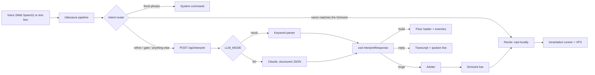

# Incant Online

**Say it. Cast it.**

Incant Online is a browser-based, voice-first action RPG. You play an **Incanter** climbing **the Spire**. You don't pick spells from a menu: you *describe* them out loud ("a spinning fire slash that hits three times") and the Spire forges them. Then you cast them by saying their names. When a floor is cleared, a gate opens, and you describe the next floor into being.

Plain language becomes both **working game logic** (Incantations with real hitboxes, damage, status effects, cooldowns and mana) and **3D places** (floors with lighting, props and enemies), in real time, in the browser, and it never breaks, whatever you say.

> Built in TypeScript with Three.js and Rapier. Runs fully in a desktop browser; the only backend is one serverless function. **Best in Chrome or Edge.**

---

## Contents

- [Features](#features)
- [Quick start](#quick-start)
- [How to play](#how-to-play)
- [Things to say](#things-to-say)
- [The problem we're exploring](#the-problem-were-exploring)
- [How it works](#how-it-works)
- [The Arbiter (balancing)](#the-arbiter-balancing)
- [Combat: every type × shape](#combat-every-type--shape)
- [LLM modes and robustness](#llm-modes-and-robustness)
- [Project structure](#project-structure)
- [Scripts](#scripts)
- [Testing](#testing)
- [Deploying](#deploying)
- [Performance](#performance)
- [How AI is used](#how-ai-is-used)
- [Privacy](#privacy)
- [Roadmap](#roadmap)
- [Credits and licence](#credits-and-licence)

---

## Features

- **Forge Incantations by voice or text.** Describe an ability; it is turned into a validated `IncantationSpec`, balanced by the Arbiter, and placed on your Grimoire bar.
- **Recite to cast.** Say an Incantation's name ("Frost Comet") and it fires immediately, matched locally with fuzzy search. No network round-trip; it can even fire from the live transcript before you finish speaking.
- **Refine what you made.** "make it wider", "add a stun", "remove the burn", "make it ice". The Incantation keeps its slot and is re-balanced.
- **Build floors by description.** "a cozy village at night", "build a frozen castle with archers". A new floor rises behind a "The Spire reshapes…" transition.
- **Climb the Spire.** Defeat every enemy and a gate opens; step in and describe the next floor.
- **Real combat for any spec.** 7 delivery types × 7 shapes, multi-hit combos, chain lightning, burn / freeze / stun / slow / knockback / heal, wards, dashes, mana and cooldowns.
- **Readable, glowing VFX.** Effects driven by shape and element, emissive materials and a bloom pass.
- **The Arbiter.** Deterministic balancing after the LLM: power score → cooldown and mana, bans instant kills and long invulnerability, explains every change in one sentence.
- **A voice that answers.** In-character replies are shown and spoken (text-to-speech), and fall silent the moment you hold the talk key.
- **Never a crash, never an error page.** Off-topic, nonsense or impossible requests always end in a floor, an Incantation or an in-character reply. Verified by `npm run judge-test`.
- **Playable without an API key.** Mock mode uses a local keyword parser that produces the same JSON as the LLM.

## Quick start

**Requirements:** Node.js 22.18 or newer (24 recommended) and a desktop browser (Chrome or Edge for voice).

```bash
git clone https://github.com/mikaelaMolina/incant-online.git
cd incant-online
npm install
npm run dev            # http://localhost:5173 (also serves /api)
```

That's it: with no API key the game runs in **mock mode** (a "Mock mode" label shows top-right) and is fully playable.

To use Claude for interpretation instead:

```bash
cp .env.example .env   # git-ignored
# then set ANTHROPIC_API_KEY=... in .env and restart npm run dev
```

| Variable | Default | Meaning |
| --- | --- | --- |
| `ANTHROPIC_API_KEY` | *(empty)* | Server-side only. Empty → mock mode. |
| `LLM_MODEL` | `claude-haiku-5-5` | Model used in llm mode (a fast model, for latency). |
| `LLM_MODE` | *(unset)* | `mock` forces mock mode even with a key. |

Keys are only read by the serverless function and are never sent to the browser.

## How to play

1. Open the page and say **"I speak, I enter"** (hold V while speaking), or press Enter to skip voice.
2. Fight with the staff and the three starter Incantations on keys **1–3**.
3. Hold **V** and describe new Incantations; say their names to cast them.
4. Clear the floor, walk into the gate, and describe the next floor.

### Controls

| Input | Action |
| --- | --- |
| W A S D | Move (relative to the camera) |
| Mouse | Aim (the Incanter faces the cursor) |
| Left click | Staff strike (short arc in front of you) |
| Space | Dodge (brief invulnerability: roll through arrows and slams) |
| 1 – 6 (or numpad) | Cast the Incantation in that Grimoire bar slot |
| Hold V (or the mic button) | Push-to-talk: speak, then let go |
| Enter | Type instead of speaking (Enter again sends, Esc cancels) |
| F3 | Toggle the performance overlay (on by default in `npm run dev`) |

### The HUD

- **Grimoire bar** (left): six slots with mana cost, cooldown and a cooldown sweep. Slots 1–3 start with *Blazing Cyclone* (fire spin, burn), *Thunder Chain* (lightning that leaps between foes, stun) and *Frost Comet* (ice bolts that burst and freeze).
- **Mana and health** (bottom left). Mana regenerates; every Incantation's cost is set by the Arbiter.
- **Transcript** (bottom): what you said and what the Arbiter answered.
- **Mode label** (top right): "Mock mode" without a key, "Offline: cached Incantations" if the backend can't be reached.

## Things to say

| You say | What happens |
| --- | --- |
| "a spinning fire attack that hits three times" | Forges *Blazing Cyclone* (melee spin, burn) into the next free slot |
| "Blazing Cyclone" / "cast Frost Comet" | Recites: casts instantly, no network call |
| "make it wider" · "add a stun" · "make it ice" | Refines your last Incantation in place |
| "a chain of lightning that bounces to four enemies" | Forges a chain Incantation |
| "heal me" | Forges a light healing ward |
| "build a misty forest at night with archers" | Builds a new floor |
| "put a dragon on a castle" | A castle floor with a dragon boss |
| "make it night" | Refines the current floor |
| "open Grimoire" · "close Grimoire" · "next floor" | System commands (local) |
| "kill everything instantly" | The Arbiter refuses instant death and grants the strongest blast it allows |
| "a spell that turns enemies into frogs" | The closest allowed effect (a stun), with a line explaining why |
| "what is this game?" | An in-character explanation of how to play |
| "asdf" | An in-character reply, never an error |

## The problem we're exploring

Language models are good at understanding what people mean, but letting one *write game code* at runtime is slow, unsafe and fragile: a single bad answer can crash the game or break its balance. We wanted to know: **can plain spoken language drive both a playable 3D world and real game mechanics, in real time, without ever letting the model break the game?**

Our answer is a strict division of labour:

1. **The model only fills in data.** It never writes code. It fills fixed JSON shapes (`IncantationSpec`, `FloorSpec`) using structured output.
2. **Everything is validated and repaired.** Shared zod schemas clamp numbers to range, map unknown values to the nearest valid one ("flames" → fire, "bolt" → orb) and fill defaults, on the server and again in the browser.
3. **A deterministic referee has the last word.** The Arbiter scores the power of every Incantation, sets its cooldown and mana, bans instant kills and long invulnerability, and explains changes in one sentence. Balance doesn't depend on the model behaving.
4. **The engine is generic.** One runner executes *any* valid spec: every type, shape, hit count, radius, chain and status effect. A new idea needs no new code.
5. **There is always a fallback.** Timeouts, bad JSON, rate limits or no key at all end in a mock-parser result, a cached Incantation or floor, or an in-character reply.
6. **The fast path is local.** Casting by name never touches the network, so combat stays responsive while the model works on something else.

## How it works



**Voice routing** (in this order, `src/voice/intentRouter.ts`):

1. **Recite.** Fuse.js match against Grimoire names (threshold 0.4). Cast instantly, no network.
2. **System command.** "open/close Grimoire", "next floor".
3. **Refine.** Starts with "make it", "add", "remove"…: sent with the last Incantation and the current floor as context.
4. **Gate.** While standing in an open gate, anything else describes the next floor.
5. **Everything else** → `/api/interpret` → forge, build or reply.

### Data shapes

The model (or the mock parser) only ever produces this:

```jsonc
// InterpretResponse
{ "intent": "forge" | "build" | "reply", "incantation"?: IncantationSpec, "floor"?: FloorSpec, "reply"?: string }
```

**IncantationSpec** (example):

```json
{
  "name": "Blazing Cyclone",
  "flavor": "Three spinning cuts wreathed in fire.",
  "type": "melee_combo",
  "shape": "spin",
  "hits": 3,
  "radius": 3.5,
  "damage_per_hit": 18,
  "element": "fire",
  "status_effect": { "kind": "burn", "dps": 4, "duration": 3 },
  "chain_targets": 0,
  "cooldown": 8,
  "mana_cost": 20,
  "vfx": { "color": "#ff6a1a", "trail": true, "particles": "embers" }
}
```

| Field | Allowed |
| --- | --- |
| type | melee_combo, projectile, area, beam, chain, buff, dash |
| shape | slash, thrust, spin, cone, circle, line, orb |
| hits / radius / damage_per_hit | 1–5 / 1–8 m / 5–60 |
| element | physical, fire, ice, lightning, wind, light, shadow |
| status_effect.kind | none, burn, freeze, stun, slow, knockback, heal (duration 0–10 s) |
| chain_targets / cooldown | 0–5 / 1–60 s |

**FloorSpec**: name, biome (forest, ruins, ice, desert, cavern, castle, void), lighting (time of day, fog, ambient colour), size, props (only models from `public/assets/manifest.json`, instanced) and enemy spawns. Each `EnemySpec` has an archetype (melee, ranged, tank, boss) and runs an idle → chase → attack → flee state machine. Meshes are never generated at runtime.

## The Arbiter (balancing)

Deterministic code that runs on every Incantation after the model (`src/arbiter`):

```
P = d × h × (1 + r/4) × (1 + 0.5c) + E
```

`d` damage per hit, `h` hits, `r` radius (area shapes only: spin, cone, circle), `c` chain targets, `E` the effect's worth (burn dps × duration, 15 per second of stun or freeze, 8 per second of slow, 10 for knockback, the amount healed).

1. Clamp every field to its range.
2. Ban instant kills, invulnerability over 3 s and self-buffs over +50%; swap in the closest allowed effect.
3. `cooldown = max(requested, ceil(P / 14))`.
4. If that would exceed 60 s, scale damage down until it fits.
5. `mana_cost = round(P × 0.2)`.
6. Explain any change in one templated sentence, e.g. *"The Spire resists such power: cooldown raised to 60 s, damage reduced by 40%."*

Blazing Cyclone above scores P ≈ 113 → cooldown 9 s, 23 mana, accepted (a required unit test).

## Combat: every type × shape

`type` decides **how** hits are delivered; `shape` decides **what area** each hit covers; `radius` scales it (`src/combat/castPlan.ts`, pure and unit-tested).

| Type | Delivery |
| --- | --- |
| melee_combo | `hits` swings around the Incanter, alternating sides |
| area | pulses on the Incanter, or on the aim point (orb) after a ground telegraph |
| projectile | bolts toward the aim; orbs and circles explode, slashes and lances pierce, cones fire a fan |
| beam | a channelled beam that follows your aim and stops at walls; spin sweeps a full circle, cone breathes |
| chain | strikes the foe nearest your aim, then leaps to `chain_targets` more at half damage |
| buff | an aura that pulses around you; heal restores HP, freeze/stun wards make you untouchable (≤ 3 s) |
| dash | dashes toward the aim with i-frames, hitting everything on the path, then finishers of the shape |

| Shape | Area of one hit |
| --- | --- |
| slash | wide arc in front |
| thrust | narrow strip |
| spin, circle | full circle |
| cone | narrow, long arc |
| line | long strip |
| orb | a ball ahead of you (or an explosion) |

Status effects on enemies: **burn** (damage over time), **freeze / stun** (can't move or attack; interrupts wind-ups), **slow** (half speed), **knockback**. Every type × shape combination is tested against a real physics world (`src/combat/incantationRunner.test.ts`).

VFX (`src/vfx`) are presets by shape (arcs, spikes, rings, shockwaves, beams, orbs, bolts, auras), coloured by element and spec, using emissive (HDR) materials, one pooled particle cloud (max 2,400 particles, one draw call) and a bloom pass tuned so only spell effects glow.

## LLM modes and robustness

| Mode | When | What interprets the words |
| --- | --- | --- |
| **mock** | No `ANTHROPIC_API_KEY`, or `LLM_MODE=mock` | Local keyword parser (`api/_lib/mock/`) |
| **llm** | Key set | Claude via the Messages API (raw HTTP, structured JSON output, low effort for latency) |

Both modes return the same `InterpretResponse` and take the same path: zod validation on the server, again in the browser, then the Arbiter. Switching to the real model only means setting the key. The system prompt includes the schema, allowed values and six example pairs **generated by the mock parser**, so both modes agree.

Safeguards on `/api/interpret`: 300-character input cap, per-IP rate limit (20 requests / 10 min), 8 s timeout, one retry on bad JSON, and a cached fallback (10 Incantations, 3 floors) for every failure. The browser adds its own time budget, so describing a floor stays under 10 s even if the backend is slow.

Impossible or forbidden asks are steered, not refused: *"kill everything instantly"* becomes the strongest blast the Arbiter permits, *"turn enemies into frogs"* becomes a stun, each with one in-character sentence explaining the change.

## Project structure

```text
src/
  game/      scene, Incanter, camera, input, floor loader, gate
  combat/    cast planning, Incantation runner, hit detection, status effects, mana, Grimoire
  enemies/   archetypes, state machine, spawner
  voice/     push-to-talk, speech input, intent router, command router, narrator (TTS)
  arbiter/   power score and balancing rules (pure functions + tests)
  vfx/       palettes, materials, particles, shape presets, bloom
  ui/        HUD, Grimoire bar and panel, transcript, start screen, transition
  schemas/   zod: IncantationSpec, EnemySpec, FloorSpec, InterpretResponse, manifest
  fallback/  cached Incantations and floors
api/
  interpret.ts       Vercel function: GET → { mode }, POST → InterpretResponse
  _lib/              shared backend code: mode, rate limit, LLM client and prompt
  _lib/mock/         the mock-mode keyword parser
public/assets/       CC0 low-poly models (Kenney, Quaternius) + manifest.json
scripts/             manifest builder, API ESM check, judge test
```

## Scripts

| Command | What it does |
| --- | --- |
| `npm run dev` | Dev server with hot reload; also serves `/api/*` from the same function files |
| `npm run build` | Type-check, production build into `dist/`, and the API ESM check |
| `npm run preview` | Serve the production build |
| `npm test` | Unit and integration tests (Vitest) |
| `npm run typecheck` | TypeScript only |
| `npm run judge-test` | Sends ten "judge-style" prompts to `/api/interpret` and checks every one ends in a valid floor, Incantation or reply. `-- --url https://…` tests a deployment; extra arguments are your own prompts |
| `npm run check:api` | Runs `/api` under plain Node ESM the way Vercel does (catches import problems before deploy) |
| `npm run manifest` | Regenerate `public/assets/manifest.json` after changing asset packs |

## Testing

```bash
npm test             # ~190 unit and integration tests
npm run judge-test   # end to end over HTTP against a local dev server
```

Highlights:

- **Arbiter**: the required Blazing Cyclone case, clamps, bans and the cooldown and mana formulas.
- **Combat**: every type × shape lands damage in a real Rapier world; chains split 100% / 50% / 50%; mana, cooldown, heal, ward and dash.
- **Voice routing**: recite threshold and false positives, casting from interim transcripts, refine keeps the bar slot (even when renamed), system commands, the gate.
- **Robustness**: mock-parser answers to judge-style prompts; cached floors and Incantations are valid and use real assets; request time budgets.

## Deploying

The app is a static Vite build plus one Vercel serverless function (`api/interpret.ts`).

1. Import the repo into Vercel (framework preset: Vite; build command `npm run build`; output `dist`).
2. Optionally set `ANTHROPIC_API_KEY` (and `LLM_MODEL`) in Project Settings → Environment Variables to switch on llm mode.
3. Check it: `npm run judge-test -- --url https://your-deployment.vercel.app`.

> Status: the API is verified to run under plain Node ESM (`npm run check:api`), but the first Vercel deployment and the real-LLM path have not been tested end to end yet.

## Performance

Targets: 60 fps on a mid-range laptop (30 minimum), recite → cast < 500 ms, forge < 6 s (p90), floor build < 10 s, first load < 8 s, < 150 draw calls, < 3,000 particles.

How we get there: instanced props, a single pooled particle system, shared VFX geometries, fixed-step physics with interpolation, and local recital (a typed recital measured 38 ms even under software rendering). A full frame including the bloom passes measured about 124 draw calls. Press F3 for the live overlay (fps, draw calls, triangles, particles).

## How AI is used

- **At runtime**, an LLM (Claude, via the Anthropic Messages API) turns what the player says into JSON that matches fixed schemas. It never writes code. Every result is validated with zod and every Incantation is balanced by the deterministic Arbiter. Without a key, a keyword parser produces the same JSON (mock mode). If anything fails, the game answers from cached content, never with an error.
- **Speech** uses the browser's Web Speech API (speech to text) and `speechSynthesis` (the Arbiter's voice).
- **Development**: this codebase was written with the help of Claude Code, an AI coding assistant by Anthropic.

All AI components and third-party assets are listed with provider and licence in [CREDITS.md](CREDITS.md).

## Privacy

- The microphone is **push-to-talk only** (hold V or the mic button) and closes as soon as you let go.
- Browser speech recognition **may send your audio to your browser vendor** (e.g. Google or Microsoft) to turn it into text.
- Our backend **never stores audio**. Only the text of what you said is sent to `/api/interpret`, and in llm mode on to the model provider.
- API keys live only in server-side environment variables and are never sent to the browser.

## Roadmap

- Judgement card: show the Arbiter's verdict when an Incantation is forged.
- More spoken Arbiter lines, a guide NPC and `/api/talk`.
- `/api/stt` for browsers without built-in speech recognition (until then the game asks you to type).
- First Vercel deployment and a real-LLM test pass.
- Performance pass, boss phases, demo video.

## Credits and licence

Code: [MIT](LICENSE) © 2026 Mikaela Molina.

3D models: CC0 packs by [Kenney](https://kenney.nl) and [Quaternius](https://quaternius.com). Libraries: Three.js (MIT), Rapier (Apache-2.0), postprocessing (Zlib), Fuse.js (Apache-2.0), zod (MIT) and others. Full list with sources and licences: [CREDITS.md](CREDITS.md).

Incant Online is an original work. All names, characters and places in it are original.
