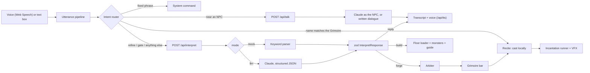

<p align="center"></p>

# Incant Online

**Say it. Cast it.**

Incant Online is a browser-based, voice-first action RPG. You play an **Incanter**, a hero whose words become power. You don't pick a world or spells from a menu: you **say them**. Describe the world you want and the game builds it in 3D. Describe a spell ("a spinning fire slash that hits three times") and it becomes a working ability with real hitboxes, damage and cooldowns. Then cast it by saying its name. Along the way you walk a peaceful village, talk to its people, take quests, and climb **the Spire** floor by floor, describing each new floor into being.

Plain language becomes both **3D places** (lighting, scenery, monsters, villagers) and **working game logic** (Incantations the engine executes), in real time, in the browser, and the game never breaks, whatever you say.

> TypeScript, Three.js and Rapier physics in the browser; small serverless functions for the AI. **Best in Chrome or Edge.** Fully playable without any API key (mock mode).

---

## Contents

- [For judges: a two-minute tour](#for-judges-a-two-minute-tour)
- [What you can do](#what-you-can-do)
- [The problem we're exploring](#the-problem-were-exploring)
- [How AI is used](#how-ai-is-used)
- [How this meets the brief](#how-this-meets-the-brief)
- [Run it locally](#run-it-locally)
- [How to play](#how-to-play)
- [Browser support](#browser-support)
- [Privacy](#privacy)
- [Under the hood](#under-the-hood): how it works, the Arbiter, combat, AI modes and fallbacks, project structure, scripts, testing, deploying, performance
- [Roadmap](#roadmap)
- [Credits and licence](#credits-and-licence)

---

## For judges: a two-minute tour

1. **Describe your world.** On the start screen, hold **V** (or the mic button) and say a place, type one and press **Build**, or open **Choose it** and pick a place, time of day, danger and who lives there.
2. **Meet the village.** You arrive in *The Threshold*, a peaceful camp at the foot of the Spire, while your world is built in the background. Walk up to a villager (**WASD**) and talk to them: hold **V** and ask anything, or press **Enter** and type. The **Knight** gives you your first quest.
3. **Enter your world.** Step through the glowing gate. Your described world is Floor 1. Fight with left click and keys **1–3**.
4. **Invent a spell.** Hold **V**: *"a chain of lightning that bounces to four enemies"*. It lands on your bar; say its name to cast it.
5. **Try to break it.** Type anything: *"kill everything instantly"*, *"turn enemies into frogs"*, *"what's the weather in Paris?"*, *"asdf"*. Every input ends in a world, a spell or an in-character answer, never an error.

Prompts worth trying:

| Where | Say or type | What happens |
| --- | --- | --- |
| Start screen | "a volcano fortress at dusk" | Your world: a cavern floor at dusk, built by the AI |
| Village | "who are you?" / "what's beyond the gate?" | The villager answers in character, from their own story |
| Anywhere | "a spinning fire attack that hits three times" | A new Incantation, balanced by the Arbiter |
| Anywhere | "make it ice" · "add a stun" | Refines your last Incantation in place |
| At a gate | "a misty forest at night with archers" | The next floor |
| Anywhere | "kill everything instantly" | The strongest blast the rules allow, with an explanation |

## What you can do

- **Speak or choose your world.** Describe it in your own words, or build it from picture cards (where, when, danger, who lives there). Either way your words go to the AI, which builds the 3D floor.
- **Begin with a story, not a fight.** The climb opens in a peaceful prologue village. The Arbiter, the Spire's voice, tells you where you are; four villagers (an Elder, a Villager, a Knight and a Wanderer) each know a different part of the story.
- **Talk to NPCs, really.** Walk up to anyone and speak or type. With an API key, Claude plays each character in their own voice, from their own background and the story so far, and remembers your last few exchanges. Without one, they answer from their written dialogue.
- **Take quests.** NPCs give you tasks: clear the next floor, defeat the guardian, gather healing orbs. Finishing one earns bonus experience and a full heal.
- **Return to the village between climbs.** After every guardian (every third floor), the gate leads back to the village to rest, talk and take a new quest, then on up the Spire.
- **Forge Incantations by voice or text.** Describe an ability; it becomes a validated `IncantationSpec`, balanced by the Arbiter, on your Grimoire bar.
- **Recite to cast.** Say an Incantation's name ("Frost Comet") and it fires immediately, matched locally with no network round-trip, even from the live transcript before you finish speaking.
- **Refine what you made.** "make it wider", "add a stun", "remove the burn", "make it ice". The Incantation keeps its slot and is re-balanced.
- **Climb.** Clear a floor and a gate opens; describe the next floor into being. Monsters fit each place, every third floor ends with a named guardian, and a five-chapter story unfolds as you climb.
- **Hear the world.** The Arbiter and the villagers speak in a natural AI voice (ElevenLabs), with the browser's voice as a fallback.
- **Ask for anything.** Off-topic, nonsense or impossible requests always end in a floor, an Incantation or an in-character reply.

## The problem we're exploring

Language models are good at understanding what people mean, but letting one *write game code* at runtime is slow, unsafe and fragile: a single bad answer can crash the game or break its balance. We wanted to know: **can plain spoken language drive both a playable 3D world and real game mechanics, in real time, without ever letting the model break the game?** And can the same language make a game world feel alive: places you name, people you can actually talk to?

Our answer is a strict division of labour:

1. **The model only fills in data.** It never writes code. It fills fixed JSON shapes (`IncantationSpec`, `FloorSpec`) using structured output, and can only use 3D models and monsters the game already has.
2. **Everything is validated and repaired.** Shared zod schemas clamp numbers to range, map unknown values to the nearest valid one ("flames" → fire, "bolt" → orb) and fill defaults, on the server and again in the browser.
3. **A deterministic referee has the last word.** The Arbiter scores the power of every Incantation, sets its cooldown and mana, bans instant kills and long invulnerability, and explains changes in one sentence. Balance doesn't depend on the model behaving.
4. **The engine is generic.** One runner executes *any* valid spec: every type, shape, hit count, radius, chain and status effect. A new idea needs no new code.
5. **There is always a fallback.** Timeouts, bad JSON, rate limits or no key at all end in a mock-parser result, a pre-forged Incantation or pre-built floor, a written NPC line, or an in-character reply.
6. **The fast path is local, the slow path is hidden.** Casting by name never touches the network. Your world is built while you explore the village, so you never wait on a loading screen for it.

## How AI is used

AI does the *understanding* and the *talking*; deterministic code does the *deciding*.

### 1. Interpret: words → game data (Claude)

Everything you say that isn't a spell name, a fixed command or a conversation goes to `/api/interpret`. Claude (Anthropic Messages API, `claude-haiku-5-5` by default, for speed) answers with JSON in one fixed shape: **forge** an Incantation, **build** a floor, or **reply** in character. The system prompt carries the schema, the allowed values, the prop and monster models that exist, the current story chapter, and six worked examples. Floors arrive in about 5 s; Incantations in about 2 s.

- The answer is validated with zod on the server and again in the browser.
- "Make it…" requests are sent with your last Incantation and the current floor, so only what you asked for changes.
- Impossible asks are steered, not refused: turning foes into frogs becomes a stun, stopping time a freeze, each with a sentence explaining why.

### 2. NPC conversation (Claude)

Talking to a villager or a floor's guide goes to `/api/talk`. Claude plays that character, briefed with their written background (what they know, how they speak) and the current chapter of the story, with your last few exchanges as memory. Replies are at most two short spoken sentences and never break character; off-topic questions are deflected in the character's own voice. Without a key, or if the call fails, the NPC answers from its written dialogue.

### 3. The Arbiter: the model proposes, rules decide (not AI)

Plain, deterministic code that runs on **every** Incantation after the model, whoever produced it. It scores power (`P = d × h × (1 + r/4) × (1 + 0.5c) + E`), sets cooldown and mana from that score, caps or swaps forbidden effects, and explains any change in one sentence: *"The Spire resists such power: cooldown raised to 60 s."*

### 4. Voice: speaking and being answered

- **Speech in**: the browser's speech recognition (Web Speech API), push-to-talk, live. In browsers where that doesn't work (Firefox, Brave, Opera…) the game records while you hold the key and `/api/stt` turns the clip into text with ElevenLabs Speech to Text (about 1 s). Spell names are matched locally with fuzzy search (Fuse.js), so a misheard "Blazing Cycle On" still casts *Blazing Cyclone*.
- **Speech out**: the Arbiter and the NPCs speak with an ElevenLabs AI voice through `/api/tts`. Fixed lines (the prologue, villagers' dialogue, story beats) are **pre-recorded** with `npm run voices`, so they cost nothing at runtime; new lines are generated once and cached. Without a key, the most natural voice your browser has is used (Edge's neural voices are the best). Everyone falls silent the moment you hold the talk key. **The voices are AI-generated, not human.**

### Built with AI, too

This codebase was written with the help of Claude Code, an AI coding assistant by Anthropic. Every AI component (Claude Code, the Anthropic Messages API, ElevenLabs, the browser speech services) and every third-party library and asset is listed with provider and licence in [CREDITS.md](CREDITS.md).

## How this meets the brief

| Requirement | How Incant Online meets it |
| --- | --- |
| Runs fully in a desktop web browser; backend may be serverless | The whole game runs in the browser (WebGL2). The backend is four small Vercel serverless functions: `/api/interpret`, `/api/talk`, `/api/tts`, `/api/stt`. |
| Plain language becomes **both** 3D scenes **and** working logic | Described places become 3D floors (`FloorSpec`: biome, lighting, scenery, monsters). Described abilities become executable Incantations (`IncantationSpec`) with real hitboxes, damage, status effects and cooldowns. |
| Judges may type any prompt, including off-topic ones | Every input ends in a floor, an Incantation or an in-character reply. Failures, timeouts and rate limits fall back to cached content, never an error page. Checked by `npm run judge-test` (ten judge-style prompts) and unit tests. |
| Only permissive dependencies and assets | MIT, Apache-2.0, BSD, ISC, Zlib and CC0 only. The Anthropic SDK and Tailwind were rejected for transitive licences outside that list; the APIs are called over plain HTTP. All 3D models, sounds and NPC characters are CC0. |
| Credit every third-party and AI component | [CREDITS.md](CREDITS.md): every library, asset pack, AI service (Claude API, ElevenLabs, browser speech) and the AI coding assistant, with source and licence. |
| No secrets in the repo | API keys live only in `.env` (git-ignored) and the host's environment variables, are read only by the serverless functions, and never reach the browser. |
| Privacy | Push-to-talk only. The start screen and this README say that browser speech recognition may send audio to the browser vendor; the backend never stores audio. |
| Original IP | All names, characters, places, story and dialogue are original. |
| Open licence | [MIT](LICENSE). |

## Run it locally

**Requirements:** Node.js 22.18 or newer (24 recommended) and a desktop browser (Chrome or Edge for voice).

```bash
git clone https://github.com/mikaelaMolina/incant-online.git
cd incant-online
npm install
npm run dev            # http://localhost:5173 (also serves /api)
```

With no keys the game runs in **mock mode** (a "Mock mode" label shows top right) and is fully playable: a local keyword parser builds worlds and spells, NPCs speak their written lines, and the browser provides the voice.

To switch on the AI:

```bash
cp .env.example .env   # git-ignored
# set ANTHROPIC_API_KEY (and optionally ELEVENLABS_API_KEY), then restart npm run dev
```

| Variable | Default | Meaning |
| --- | --- | --- |
| `ANTHROPIC_API_KEY` | *(empty)* | Claude for worlds, spells and NPC conversation. Empty → mock mode. |
| `LLM_MODEL` | `claude-haiku-5-5` | Model used in llm mode (a fast model, for latency). |
| `LLM_MODE` | *(unset)* | `mock` forces mock mode even with a key. |
| `ELEVENLABS_API_KEY` | *(empty)* | The AI voice for the Arbiter and NPCs, and speech-to-text for browsers without built-in recognition. Empty → the browser's voice; voice input only in Chrome and Edge. |
| `TTS_VOICE` / `TTS_MODEL` | Eldrin (`6WwXjDDEMyNmFG95zycZ`) / `eleven_flash_v2_5` | ElevenLabs voice and model. |

Keys are only read by the serverless functions and are never sent to the browser. Other commands: `npm test`, `npm run judge-test`, `npm run build` (type-check, production build, API check), `npm run voices` (pre-record fixed lines).

Open the game at **http://localhost** (or HTTPS): browsers only allow the microphone on secure origins, so voice input does not work from a LAN IP address.

## How to play

1. **Describe or choose your world** on the start screen (hold V and speak, type and press Build, or use Choose it).
2. **Explore the village.** Talk to the four villagers; the Knight gives your first quest. The Arbiter tells the story of the Threshold.
3. **Step through the gate** into your world (Floor 1). Fight with the staff and the three starter Incantations on keys **1–3**.
4. **Forge new Incantations** by describing them; cast them by saying their names.
5. **Clear the floor**, step into the gate and describe the next floor. Each floor has a guide you can talk to, often with a quest.
6. **After every guardian** (floors 3, 6, 9…) the gate takes you back to the village to rest and take a new quest.

Kills give experience; levels raise health and mana (never spell damage, so the Arbiter's balance holds). Monsters drop health and mana orbs. Monsters fit the place: skeletons and ghosts in ruins, treants in forests, yetis on ice. Name a creature ("a cave with a dragon") and it appears.

### Controls

| Input | Action |
| --- | --- |
| W A S D | Move (up, left, down, right on screen). The Incanter faces where it walks. |
| Mouse | Aim strikes and Incantations (the Incanter turns to the aim when it attacks or casts) |
| Left click | Staff strike |
| Space | Dodge (brief invulnerability) |
| 1 – 6 (or numpad) | Cast the Incantation in that Grimoire slot |
| Hold V (or the mic button) | Push-to-talk: speak, then let go. Near an NPC, you talk to them. |
| Enter | Type instead of speaking (Enter again sends, Esc cancels) |
| M (or the button top right) | Sound and voices on/off |
| F3 | Performance overlay (on by default in `npm run dev`) |

### The HUD

- **Floor label** (top left): *Prologue*, *Village* or *Floor N*, with the floor's name; the **quest tracker** below it.
- **Grimoire bar** (left): six slots with mana cost, cooldown and a cooldown sweep.
- **Unit frame** (bottom left): level, health and mana.
- **Transcript** (bottom): what you said, what the Arbiter answered, and NPC lines under the NPC's name.
- **NPC tags**: a name tag over a villager when you are close enough to talk.
- **Mode label** (top right): "Mock mode" without a key, "Offline: cached Incantations" if the backend can't be reached.

## Browser support

| Browser (desktop) | Status |
| --- | --- |
| **Chrome, Edge** | Recommended. Everything works: 3D (WebGL2), voice input (Web Speech API), voices, sound. |
| Firefox, Brave, Opera and others | Voice works through `/api/stt` (ElevenLabs Speech to Text) when `ELEVENLABS_API_KEY` is set: the first try switches to recording, then hold V and speak again. Without the key, play with the text box (Enter). |
| Safari | Not tested. |
| Phones and tablets | Not supported: the game needs a keyboard and mouse. |

Requirements: **WebGL2**, Web Audio for sound, and a microphone for voice (optional; typing always works). Graphics quality adapts automatically if your GPU can't hold about 50 fps.

## Privacy

- The microphone is **push-to-talk only** (hold V or the mic button) and closes as soon as you let go.
- Browser speech recognition **may send your audio to your browser vendor** (e.g. Google or Microsoft) to turn it into text. In browsers without it, your push-to-talk clip goes through our server to ElevenLabs to be turned into text; it is forwarded, never stored.
- Our backend **never stores audio**. Only the *text* of what you said is sent: to `/api/interpret` or `/api/talk`, and in llm mode on to the model provider (Anthropic).
- With the AI voice on, the Arbiter's and NPCs' own lines (text, never your audio) are sent to ElevenLabs to be spoken. **The voices are AI-generated, not human.**
- API keys live only in server-side environment variables and are never sent to the browser.
- The game keeps two settings in your browser's local storage (sound and voice on/off) and nothing else.

---

# Under the hood

## How it works



**The climb**: start screen (describe or choose a world; it starts building in the background) → **prologue village** (floor 0: no enemies, four villagers, the Arbiter's narration, an open gate) → your world (floor 1) → each cleared floor opens a gate where you describe the next → after every guardian floor, back to the **village** (no climb, full rest, new quest) → on up the Spire.

**Voice routing** (in this order, `src/voice/intentRouter.ts`):

1. **Recite.** Fuse.js match against Grimoire names (threshold 0.4). Cast instantly, no network.
2. **System command.** "open/close Grimoire", "next floor".
3. **Refine.** Starts with "make it", "add", "remove"…: sent with the last Incantation and the current floor.
4. **Talk.** Near an NPC → `/api/talk` (Claude plays the NPC; written dialogue as fallback).
5. **Gate.** While standing in an open gate, anything else describes the next floor.
6. **Everything else** → `/api/interpret` → forge, build or reply (with the current story chapter as context).

### Story, NPCs and quests

- **Story** (`src/game/story.ts`): five chapters (The Awakening → The Summit, then the Endless Spire), story beats at milestone floors, chapter-aware floor subtitles, the prologue narration, and lore passed to the model so replies fit the chapter.
- **NPCs** (`src/game/npc.ts`): animated low-poly characters (Quaternius, CC0) that idle, turn to face you, show a name tag when you're near, and greet you. Four villagers in the village; one guide on each combat floor.
- **Quests** (`src/game/quests.ts`, pure and tested): one active quest at a time, offered after an NPC's greeting: clear the next floor (the village Knight), defeat the guardian, clear the floor or gather three orbs (floor guides). Rewards scale with the floor.

### Data shapes

The model (or the mock parser) only ever produces this:

```jsonc
// InterpretResponse
{ "intent": "forge" | "build" | "reply", "incantation"?: IncantationSpec, "floor"?: FloorSpec, "reply"?: string }
```

**IncantationSpec** (example):

```json
{
  "name": "Blazing Cyclone",
  "flavor": "Three spinning cuts wreathed in fire.",
  "type": "melee_combo",
  "shape": "spin",
  "hits": 3,
  "radius": 3.5,
  "damage_per_hit": 18,
  "element": "fire",
  "status_effect": { "kind": "burn", "dps": 4, "duration": 3 },
  "chain_targets": 0,
  "cooldown": 8,
  "mana_cost": 20,
  "vfx": { "color": "#ff6a1a", "trail": true, "particles": "embers" }
}
```

| Field | Allowed |
| --- | --- |
| type | melee_combo, projectile, area, beam, chain, buff, dash |
| shape | slash, thrust, spin, cone, circle, line, orb |
| hits / radius / damage_per_hit | 1–5 / 1–8 m / 5–60 |
| element | physical, fire, ice, lightning, wind, light, shadow |
| status_effect.kind | none, burn, freeze, stun, slow, knockback, heal (duration 0–10 s) |
| chain_targets / cooldown | 0–5 / 1–60 s |

**FloorSpec**: name, biome (forest, ruins, ice, desert, cavern, castle, void), lighting (time of day, fog, ambient colour), size, props (only models from `public/assets/manifest.json`, instanced) and enemy spawns. Each `EnemySpec` has an archetype (melee, ranged, tank, boss) and runs an idle → chase → attack → flee state machine. Meshes are never generated at runtime.

## The Arbiter (balancing)

Deterministic code that runs on every Incantation after the model (`src/arbiter`):

```
P = d × h × (1 + r/4) × (1 + 0.5c) + E
```

`d` damage per hit, `h` hits, `r` radius (area shapes only: spin, cone, circle), `c` chain targets, `E` the effect's worth (burn dps × duration, 15 per second of stun or freeze, 8 per second of slow, 10 for knockback, the amount healed).

1. Clamp every field to its range.
2. Ban instant kills, invulnerability over 3 s and self-buffs over +50%; swap in the closest allowed effect.
3. `cooldown = max(requested, ceil(P / 14))`.
4. If that would exceed 60 s, scale damage down until it fits.
5. `mana_cost = round(P × 0.2)`.
6. Explain any change in one templated sentence, e.g. *"The Spire resists such power: cooldown raised to 60 s, damage reduced by 40%."*

Blazing Cyclone above scores P ≈ 113 → cooldown 9 s, 23 mana, accepted (a required unit test).

## Combat: every type × shape

`type` decides **how** hits are delivered; `shape` decides **what area** each hit covers; `radius` scales it (`src/combat/castPlan.ts`, pure and unit-tested).

| Type | Delivery |
| --- | --- |
| melee_combo | `hits` swings around the Incanter, alternating sides |
| area | pulses on the Incanter, or on the aim point (orb) after a ground telegraph |
| projectile | bolts toward the aim; orbs and circles explode, slashes and lances pierce, cones fire a fan |
| beam | a channelled beam that follows your aim and stops at walls; spin sweeps a full circle, cone breathes |
| chain | strikes the foe nearest your aim, then leaps to `chain_targets` more at half damage |
| buff | an aura that pulses around you; heal restores HP, freeze/stun wards make you untouchable (≤ 3 s) |
| dash | dashes toward the aim with i-frames, hitting everything on the path, then finishers of the shape |

| Shape | Area of one hit |
| --- | --- |
| slash | wide arc in front |
| thrust | narrow strip |
| spin, circle | full circle |
| cone | narrow, long arc |
| line | long strip |
| orb | a ball ahead of you (or an explosion) |

Status effects on enemies: **burn**, **freeze / stun**, **slow**, **knockback**. Every type × shape combination is tested against a real physics world (`src/combat/incantationRunner.test.ts`).

Visuals (`src/vfx`, `src/game/atmosphere.ts`): shape presets coloured by element with HDR materials and one pooled particle cloud; bloom, neutral tone mapping, a light colour grade and vignette in one pass; a gradient sky dome with sun glow and stars; drifting ambient particles per biome (fireflies, snow, dust, embers); a rim light so characters stand out.

## AI modes and robustness

| Mode | When | Worlds and spells | NPCs | Voice |
| --- | --- | --- | --- | --- |
| **mock** | No `ANTHROPIC_API_KEY`, or `LLM_MODE=mock` | Local keyword parser (`api/_lib/mock/`) | Written dialogue | ElevenLabs if its key is set, else the browser |
| **llm** | Key set | Claude, structured JSON, low effort | Claude playing the NPC | same |

Both modes return the same `InterpretResponse` and take the same path: zod validation on the server, again in the browser, then the Arbiter. The system prompt's six example pairs are **generated by the mock parser**, so both modes agree.

Safeguards: 300-character input cap; per-IP rate limits (`/api/interpret` 20, `/api/talk` 40, `/api/tts` 60 requests per 10 min); timeouts (8 s interpret, 6 s talk and voice); one retry on bad JSON.

### When something fails

`src/fallback` holds **10 pre-forged Incantations** (covering every type, shape and element) and **3 pre-built floors**. They are used automatically:

| Failure | What the player gets |
| --- | --- |
| The model call fails, refuses or returns bad JSON twice | the closest cached item, with an in-character line |
| The model is too slow (8 s) | the same: "the Spire took too long to listen" |
| Too many requests | the same: "the Spire grows weary of your voice" |
| `/api` can't be reached or hangs (browser waits 8.5 s) | the same, worked out in the browser; the label shows "Offline: cached Incantations" |
| NPC conversation fails | the NPC's written answer |
| The AI voice fails | the browser's voice for that line |

Impossible or forbidden asks are steered, not refused: *"kill everything instantly"* becomes the strongest blast the Arbiter permits, *"turn enemies into frogs"* a stun, each with one in-character sentence explaining the change.

## Project structure

```text
src/
  game/      scene, Incanter, camera, input, floor loader, gate, atmosphere, story, NPCs, quests, progression
  combat/    cast planning, Incantation runner, hit detection, status effects, mana, Grimoire
  enemies/   archetypes, state machine, spawner
  voice/     push-to-talk, speech input, intent and command routers, narrator (voice out), fixed lines
  arbiter/   power score and balancing rules (pure functions + tests)
  vfx/       palettes, materials, particles, shape presets, post-processing
  ui/        start screen, HUD, Grimoire bar and panel, transcript, quest tracker, transition
  schemas/   zod: IncantationSpec, EnemySpec, FloorSpec, InterpretResponse, manifest
  fallback/  cached Incantations and floors, the prologue village
api/
  interpret.ts  talk.ts  tts.ts  stt.ts   Vercel functions
  _lib/         shared backend code: modes, rate limits, Claude client and prompt, NPC talk, ElevenLabs voice
  _lib/mock/    the mock-mode keyword parser
public/assets/   CC0 models (Kenney, Quaternius), sounds, pre-recorded voice lines, manifest.json
scripts/         manifest builder, NPC model packer, voice pre-recorder, API ESM check, judge test
```

## Scripts

| Command | What it does |
| --- | --- |
| `npm run dev` | Dev server with hot reload; also serves `/api/*` from the same function files |
| `npm run build` | Type-check, production build into `dist/`, and the API ESM check |
| `npm run preview` | Serve the production build (without `/api`: plays in offline fallback mode) |
| `npm test` | Unit and integration tests (Vitest) |
| `npm run judge-test` | Ten judge-style prompts to `/api/interpret`; each must end in a valid floor, Incantation or reply. `-- --url https://…` tests a deployment |
| `npm run voices` | Pre-records fixed lines with the ElevenLabs voice into `public/assets/voice/`; only new or changed lines (`-- --force` for all) |
| `npm run check:api` | Runs `/api` under plain Node ESM the way Vercel does |
| `npm run manifest` | Regenerate `public/assets/manifest.json` after changing asset packs |
| `node scripts/pack-npc-models.mjs` | Convert the NPC characters to slim GLBs (only Idle, Walk, Victory animations) |

## Testing

```bash
npm test             # ~300 unit and integration tests
npm run judge-test   # end to end over HTTP against a local dev server
```

Highlights: the Arbiter (including the required Blazing Cyclone case); every combat type × shape in a real physics world; voice routing (recite, refine, gate, talk); the start-screen flow (world prepared in the background, entered through the village gate, questions answered); the prologue and quests; `/api/talk` and `/api/tts` request shapes and every fallback; cached content validity.

## Deploying

A static Vite build plus four Vercel serverless functions (`api/interpret.ts`, `api/talk.ts`, `api/tts.ts`, `api/stt.ts`).

1. Import the repo into Vercel (framework preset: Vite; build command `npm run build`; output `dist`).
2. In Project Settings → Environment Variables, set `ANTHROPIC_API_KEY` (llm mode) and `ELEVENLABS_API_KEY` (AI voice). Both are optional.
3. Check it: `npm run judge-test -- --url https://your-deployment.vercel.app`.

> Status: the functions are verified to run under plain Node ESM (`npm run check:api`) and the AI paths have been tested live from a local dev server; the first Vercel deployment has not been done yet.

## Performance

Earlier measurements (Intel Iris Xe laptop GPU, Chromium, 1280×720, production build, mock mode):

| Target | Budget | Measured |
| --- | --- | --- |
| Frame rate, exploring | 60 fps (30 minimum) | 55–60 fps |
| Frame rate, heavy combat | 60 fps (30 minimum) | 25–105 fps depending on floor and quality level |
| Draw calls | < 150 | 66–141 on combat floors; **160–200 in the village** (59 props plus 4 NPCs: over budget, to trim) |
| Particles | < 3,000 | ≤ 680 including ambient particles (hard cap 2,400 for effects) |
| First load (to playable) | < 8 s | 3.7–5.6 s typical |
| Total download | < 25 MB | 6.8 MB at first load; NPC models (0.4–0.7 MB each) and voice lines load only when used |
| Recite → cast | < 500 ms | under 40 ms (local, no network) |
| Floor build (llm mode) | < 10 s | ~5 s for the model; hidden behind the village on the first floor |

How: instanced props; pooled particles and effect materials; shaders compiled before they're needed; fixed-step physics with interpolation; adaptive quality (MSAA, then resolution) applied off-fight. Press F3 for the live overlay. These figures predate the latest lighting and NPC work and will be re-measured.

## Roadmap

- First Vercel deployment and a full pass on the deployed AI paths.
- Trim the village to under 150 draw calls.
- Judgement card: show the Arbiter's verdict when an Incantation is forged.
- Performance on more GPUs, boss phases, demo video.

## Credits and licence

Code: [MIT](LICENSE) © 2026 Mikaela Molina.

3D models: CC0 packs by [Kenney](https://kenney.nl) and [Quaternius](https://quaternius.com) (scenery, monsters, the Incanter, NPC villagers). Sound effects: CC0 packs by rubberduck, artisticdude and Kenney. Voice: ElevenLabs (AI-generated). Libraries: Three.js (MIT), Rapier (Apache-2.0), postprocessing (Zlib), Fuse.js (Apache-2.0), zod (MIT), Basecoat (MIT), Lucide (ISC) and others. AI: Claude (Anthropic) in the game, Claude Code in development. Full list with sources and licences: [CREDITS.md](CREDITS.md).

Incant Online is an original work. All names, characters, places, story and dialogue in it are original.
